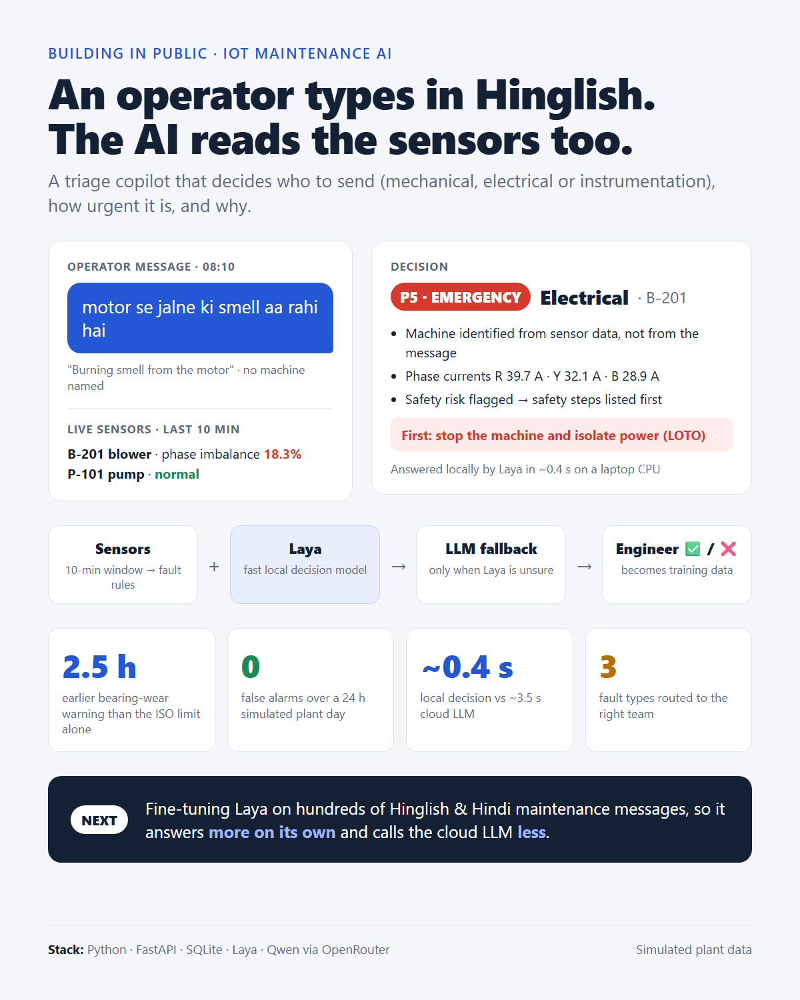

# Laya Triage

**An AI triage copilot for IoT-monitored plants.** An operator reports a problem in Hinglish, Hindi or English. The system reads the message *and* the live sensor data, then decides which team to send (mechanical, electrical or instrumentation), how urgent it is, and why.



> Built on a simulated plant. No real company data is used anywhere in this repository.

## The problem

In many plants, problems are reported as a quick message, not a dashboard alert:

> *"motor se jalne ki smell aa rahi hai"* (there's a burning smell from the motor)

Someone has to decide who goes, and how fast. The message alone is often not enough: which motor? Is it really electrical? Meanwhile the sensors may already show the answer, but nobody connects the two.

## How it works

```
operator message ──► Laya (local decision model, ~0.4 s)
                         │ confident?  ── no ──► LLM fallback (Qwen via OpenRouter)
                         ▼                                 │
sensor data ──► rule engine (last 10 min) ──► decide() ◄───┘
                                                 │
                                                 ▼
                        team · priority · reasons · first checks
                                                 │
                                engineer ✅ / ❌ ──► saved as training data
```

1. **Rule engine** ([app/rules.py](app/rules.py)) checks a 10-minute window per machine: bearing wear (ISO 10816 vibration limits), phase imbalance, a frozen flow sensor, plus two early-warning rules that compare each machine with its own normal values.
2. **Message understanding:** [Laya](https://huggingface.co/convaiinnovations/laya), a fast non-generative decision model, answers first, locally. If its confidence is below 0.5, an LLM (Qwen via OpenRouter) answers instead. A keyword guard rail flags safety words (burning, sparks, smoke…) regardless of either model.
3. **`decide()`** ([app/triage.py](app/triage.py)) combines both. Sensor warnings and alarms set the team; otherwise the operator's description does. If the operator doesn't name the machine, it is identified from the sensors. Safety risks are always priority 5, with safety steps listed first. Disagreements between the message and the sensors are written into the reasons, not hidden.
4. **Everything is saved** to SQLite: the message, the exact sensor snapshot the decision was based on, the decision, and which model made it. Engineers mark decisions ✅ or ❌ in the chat, and those labels feed the next fine-tune.

## Results

### Early fault detection (24-hour simulated day, 3 injected faults)

| Fault | Started | Detected | Delay | Caught by |
|---|---|---|---|---|
| P-101 bearing wear | 10:00 | 10:44 | 44 min | `vibration_rising` |
| B-201 phase imbalance | 03:20 | 04:16 | 56 min | `imbalance_rising` |
| P-101 flow sensor stuck | 18:20 | 18:29 | 9 min | `flow_sensor_stuck` |

- With the ISO vibration limit alone, bearing wear was detected at 13:16. The early-warning rule caught it **2.5 hours earlier**.
- **0 false alarms.** The phase-imbalance watch level (3%) was set at about 2× the worst healthy imbalance measured on the data (1.61%), not guessed.

### Fine-tuning Laya

Laya was fine-tuned on 256 synthetic maintenance messages (Hinglish, Hindi and English) on a free Kaggle GPU, then tested on 62 held-out messages it never saw.

| Synthetic test set (62 messages) | Before (zero-shot) | After (laya-maint-v1) |
|---|---|---|
| Team accuracy | 47% | **84%** |
| Machine (asset) accuracy | 90% | **100%** |
| "Is this a problem?" accuracy | 18% | **98%** |
| Messages Laya handles itself (confidence ≥ 0.5) | 18% | **74%** |
| Accuracy on the messages it handles | 64% | **93%** |
| Average confidence when right / when wrong | 0.44 / 0.34 | **0.81 / 0.38** |

The trainer's own report on the same test set: accuracy 0.52 → 0.94 across all questions, and **calibration error (ECE) 0.32 → 0.036**. In practice, the model's confidence now means something, and that is what makes the "ask the LLM only when unsure" design work.

## What I learned

- **Read the errors, not just the accuracy.** After fine-tuning, all three of the model's *confident* mistakes contained the word "motor". In the synthetic training data most motor messages were electrical (burning smell, humming, shock), so the model learned the shortcut "motor means electrical". Accuracy didn't show this; reading the mistakes did. A threshold can't fix it, because the model is confident. Better data can (planned for v2).
- **A model that knows when it's unsure beats one that is always confident.** On 7 hand-picked messages, zero-shot Laya looked reliable when confident. On 62 messages it wasn't. Small tests mislead.
- **Labels must match inputs.** Laya only sees the message text, so it is only trained on labels that can be worked out from the text. An engineer's correction that depends on the sensors is used to improve `decide()`, not to train Laya.
- **Set thresholds from data.** Alarm levels and the confidence threshold were chosen from measured noise floors and evaluation tables, and each comment in the code says where its number came from.

## Run it yourself

Requires Python 3.10+.

```powershell
git clone <this-repo-url>
cd laya
python -m venv .venv
.\.venv\Scripts\Activate.ps1
pip install -r requirements.txt

copy .env.example .env        # then put your OpenRouter key in .env

python -m simulator.generate  # simulate 24 h of plant data with 3 faults
python -m simulator.load_to_db
uvicorn app.main:app
```

Open http://127.0.0.1:8000, pick a plant time, and try:

| Time | Message | Expected |
|---|---|---|
| 08:10 | `motor se jalne ki smell aa rahi hai` | P5 electrical, B-201 (found from the sensors) |
| 21:00 | `flow meter same reading dikha raha hai` | P3 instrumentation, P-101 |
| 11:00 | `pump se thodi awaaz aa rahi hai` | P2 mechanical, P-101 (early warning) |

The API docs are at http://127.0.0.1:8000/docs.

The first run downloads the base Laya model (~650 MB) from Hugging Face. After that you can set `HF_HUB_OFFLINE=1` in `.env`. To use a fine-tuned checkpoint, set `LAYA_CHECKPOINT` to its folder.

### Checks

```powershell
python -m scripts.check_validation   # LLM output guard rails (no API calls)
python -m scripts.check_decide       # decision logic on hand-made cases (no API calls)
python -m scripts.check_rules        # rule engine on known fault moments
python -m scripts.scan_day           # minute-by-minute detection delays and false alarms
python -m scripts.evaluate           # Laya accuracy, coverage and confidence on the test sets
```

### Reproduce the fine-tune

```powershell
python -m scripts.generate_synthetic   # needs OpenRouter; set QUICK_TEST = False for the full set
python -m scripts.export_dataset       # real, reviewed decisions from the database
python -m scripts.split_dataset        # stratified train/test split; real messages are test-only
laya-train --data data/train.jsonl --eval data/test_synthetic.jsonl `
  --base convaiinnovations/laya-multilingual --out checkpoints/laya-maint-v1 --seed 42
```

On a GPU (for example Kaggle), add `--device cuda`.

## Project structure

```
app/
  config.py        machines and their normal operating values
  db.py            SQLite: readings, messages, decisions, feedback
  rules.py         rule engine (sensor fault detection)
  prompts.py       LLM extraction prompt
  llm.py           LLM call with JSON validation and retry
  laya_model.py    Laya questions, safety keyword guard rail
  triage.py        decide(): combines message + sensors; triage() pipeline
  main.py          FastAPI: /triage, /decisions, /decisions/{id}/feedback, chat page
simulator/         synthetic plant data with injected faults
scripts/           checks, evaluation, dataset export, synthetic data, split
static/index.html  chat UI with ✅ / ❌ feedback
```

## Limitations

- **Simulated plant data.** Two machines and three fault types; real plants are noisier and more varied.
- **Synthetic training data.** Messages were written by an LLM, so the model may learn LLM phrasing and shortcuts (see the "motor" finding). The real-message test set has only 5 messages so far.
- **Safety detection is a keyword list.** It is deliberately simple and predictable, but it only knows the words on the list.
- **Not production-hardened.** No authentication, and the time picker exists because the sensor data is simulated.

## Next

- **v2:** break the "motor" shortcut with targeted training data, and add real reviewed messages from the chat.
- Validate the rule engine on public real-world data (SKAB pump benchmark, NASA IMS bearing run-to-failure).
- Let Laya read the sensor snapshot as well as the message, and compare against the rule-based `decide()`.

## Credits

- [Laya](https://github.com/NandhaKishorM/laya) by Convai Innovations: the decision model and its fine-tuning tools.
- [Qwen](https://openrouter.ai/qwen) via [OpenRouter](https://openrouter.ai): LLM fallback and synthetic data generation.
- Built with Python, FastAPI, SQLite, pandas and NumPy.
